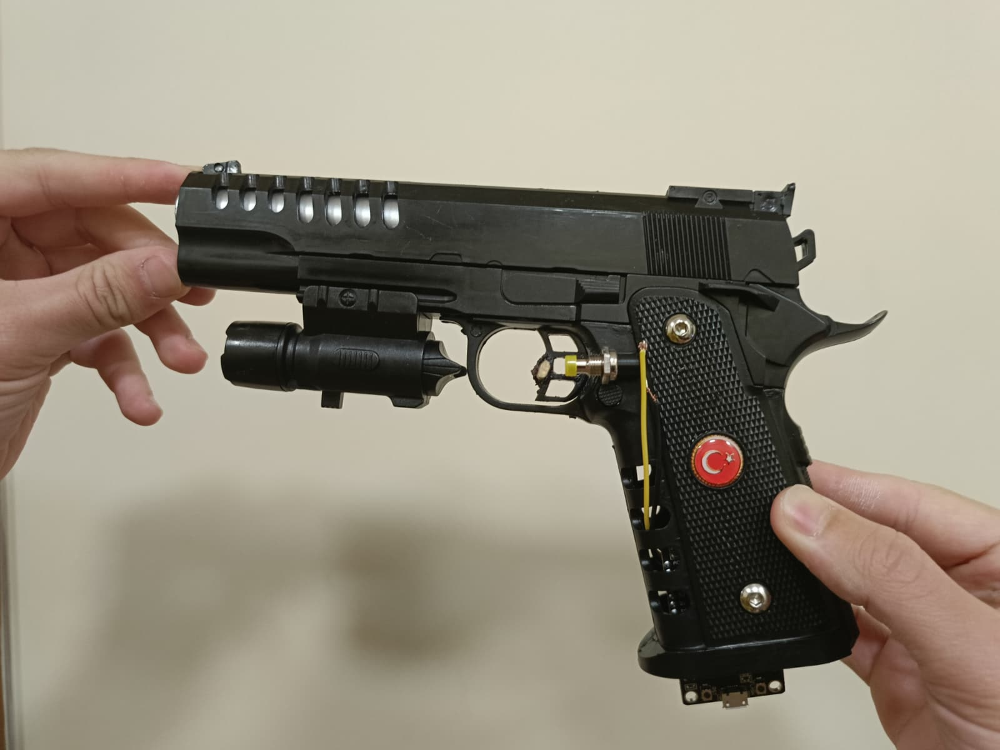
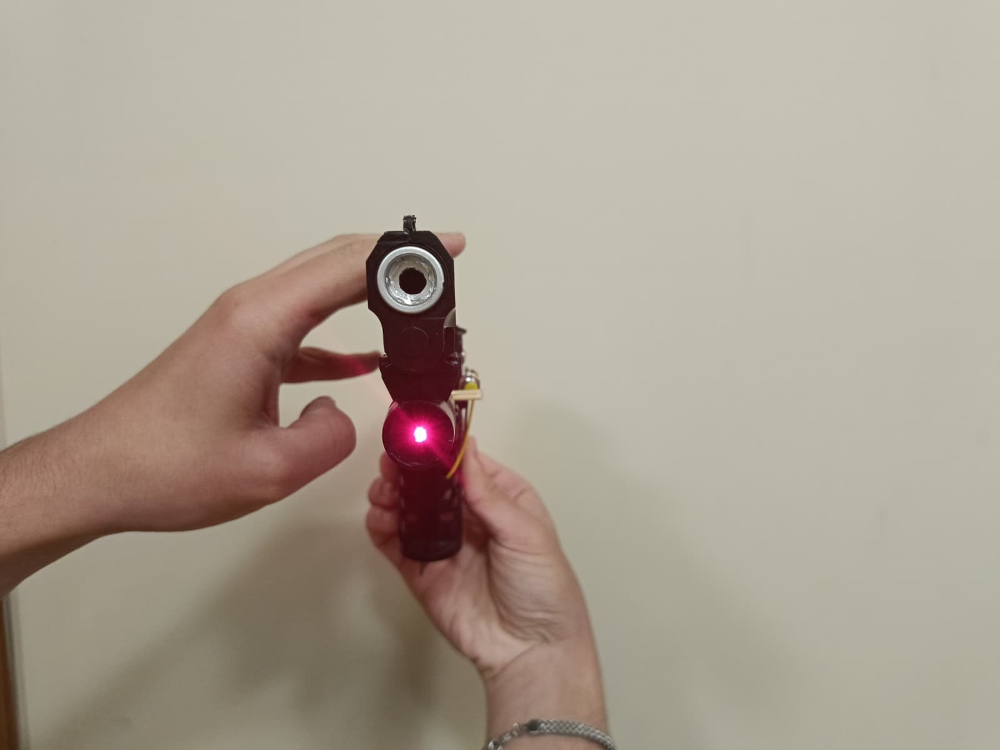
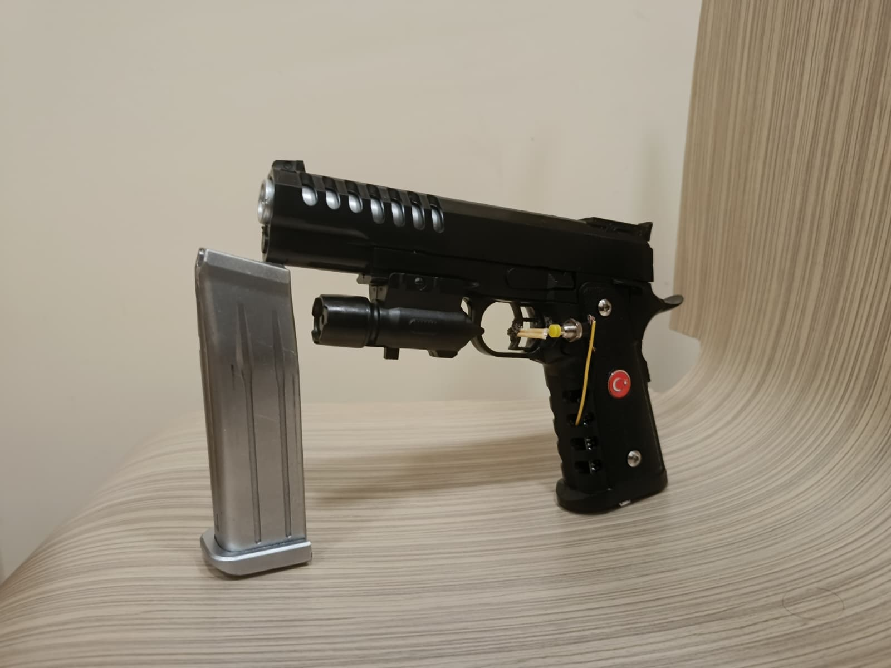
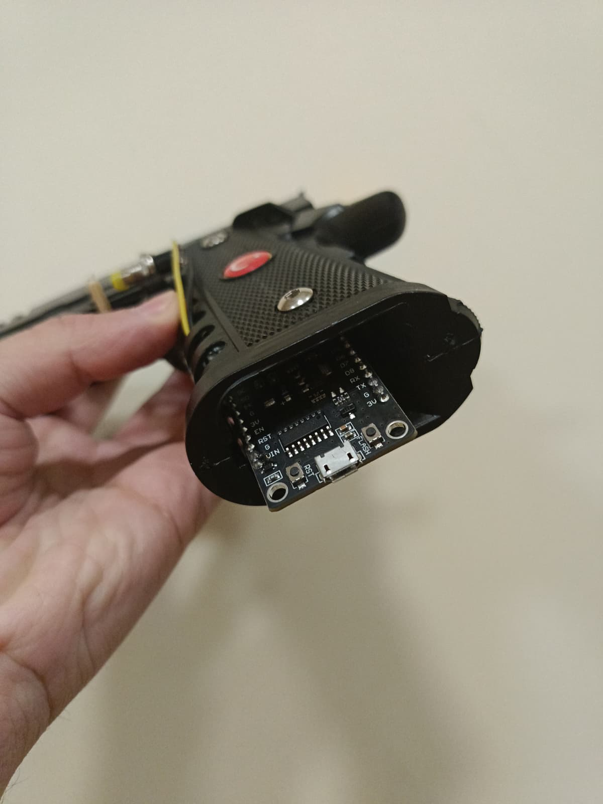
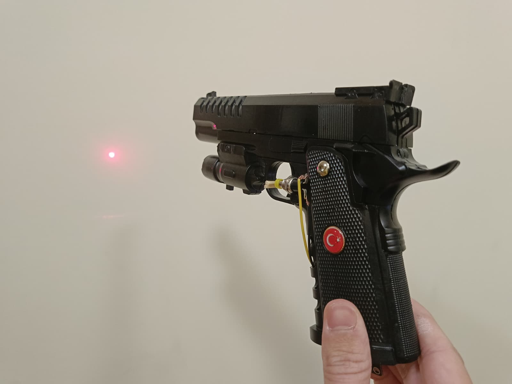

# 🎯 LaserSight – Lazer Tabanca Nişan Analiz Sistemi

Gerçek zamanlı lazer takibi ve SCATT tarzı atış performans analizi yapan, IoT destekli bir nişan analiz sistemidir.

Kamera görüntüsü üzerinden lazer noktasını tespit ederek, perspektif dönüşümü ile hedef kağıdına kalibre eder. Atış sonrası el titremesi ve tetik ezme gibi metrikleri hesaplayarak atıcının performansını analiz eder.

## 🚀 Özellikler

- **Gerçek Zamanlı Lazer Takibi** – HSV renk uzayında lazer noktası tespiti ve kontur analizi
- **Perspektif Kalibrasyon** – 4 köşe noktası ile homografi dönüşümü uygulayarak hedef kağıdını düzleştirir
- **SCATT Tarzı Analiz** – El titremesi (Hold Stability) ve tetik ezme (Trigger Jerk) metriklerini hesaplar
- **Bölge Bazlı İstatistik** – Merkez, 2. halka ve karavana yüzdelerini gerçek zamanlı gösterir
- **Playback Modu** – Atış sonrası gradyan renkli iz takibi ile yavaşlatılmış tekrar izleme
- **IoT Entegrasyonu** – NodeMCU üzerinden seri haberleşme ile tetik sinyali algılama

## 📷 Proje Demosu

Aşağıdaki görseller, lazer modülü ve NodeMCU ile donatılmış demo tabancayı göstermektedir.

<p align="center">
  
  
</p>
<p align="center">
  
  
</p>
<p align="center">
  
</p>

## 🛠️ Kullanılan Teknolojiler

| Kategori | Teknoloji |
|---|---|
| Dil | Python |
| Görüntü İşleme | OpenCV, NumPy |
| Donanım | NodeMCU (ESP8266), Lazer Modülü |
| Haberleşme | Serial (UART) |
| Kamera | IP Kamera (HTTP Stream) |

## 📋 Gereksinimler

```
Python 3.8+
opencv-python
numpy
pyserial
```

## ⚙️ Kurulum

```bash
# Depoyu klonlayın
git clone https://github.com/Ahmet-Sevli/LaserSight-Shooting-performance-analysis-based-on-laser-tracking.git
cd LaserSight-Shooting-performance-analysis-based-on-laser-tracking

# Sanal ortam oluşturun
python -m venv .venv

# Sanal ortamı aktifleştirin
# Windows:
.venv\Scripts\activate
# Linux/Mac:
source .venv/bin/activate

# Bağımlılıkları yükleyin
pip install -r requirements.txt
```

## 🎮 Kullanım

### 1. Donanım Bağlantısı
- NodeMCU'yu USB üzerinden bilgisayara bağlayın
- IP kamerayı aynı ağa bağlayın
- `görme.py` içindeki `SERIAL_PORT` ve `CAMERA_URL` değerlerini kendi cihazlarınıza göre ayarlayın

### 2. Kalibrasyon
```bash
python görme.py
```

Kalibrasyon ekranında sırasıyla şu noktalara tıklayın:
1. **1-4:** Hedef kağıdının 4 köşesi (sol üstten saat yönünde)
2. **5:** Hedefin tam merkezi (12 puan bölgesi)
3. **6:** 1. halka çeperi (yeşil çizilecek)
4. **7:** 2. halka çeperi (mor çizilecek)

### 3. Kayıt & Atış
- Kalibrasyon sonrası sistem otomatik olarak lazer takibine başlar
- Tetiğe basıldığında NodeMCU `TETIK` sinyali gönderir ve kayıt durur
- Otomatik olarak playback ve analiz ekranına geçilir

### 4. Analiz Sonuçları
Playback ekranında şu metrikler gösterilir:
- **El Titremesi (px):** Nişan alma süresindeki lazer hareketinin standart sapması
- **Tetik Ezme (px):** Tetik anında lazerin ortalama nişan noktasından sapması
- **Bölge Yüzdeleri:** Merkez / 2. Halka / Karavana dağılımı

## 📐 Sistem Mimarisi

```
IP Kamera ──(HTTP Stream)──► Python (OpenCV)
                                  │
                                  ├── HSV Lazer Tespiti
                                  ├── Perspektif Dönüşümü
                                  ├── Trajectory Kaydı
                                  └── SCATT Analiz
                                        │
NodeMCU ───(Serial/UART)───────────────►┘ (Tetik Sinyali)
```

## 👥 Geliştiriciler

- [Muhammed Taha Duran](https://github.com/Tahadn0)
- [Halime Selin Şahin](https://github.com/Selin2727)
- [Ahmet Sevli](https://github.com/Ahmet-Sevli)
